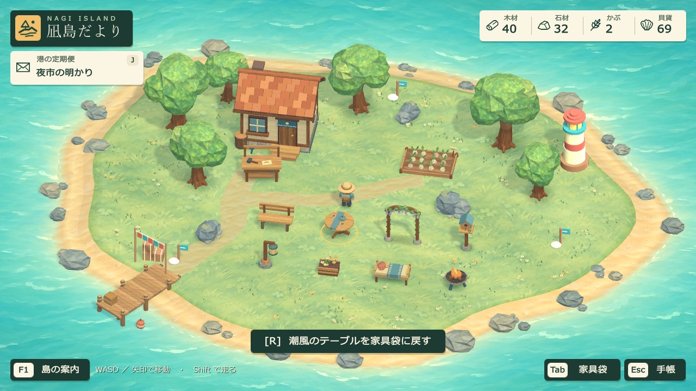

# 凪島だより

小さな島で家と畑を整え、港に船を呼ぶWindows向けの3D開拓ゲームです。渡し守の最初の頼みは、傷んだ船着き場の修繕。木と岩のそばで E を押して木材3と石2を集めましょう。J で依頼を開き、「依頼を納品する」を押すと第一便が出ます。

[遊び方と手動で拡張する方法](遊び方と編集.md)

## Unityで開く

Unity Hubでこのフォルダーを追加し、Unity 6000.3.28f1で `Assets/Island/Scenes/NagiIsland.unity` を開いて再生します。
