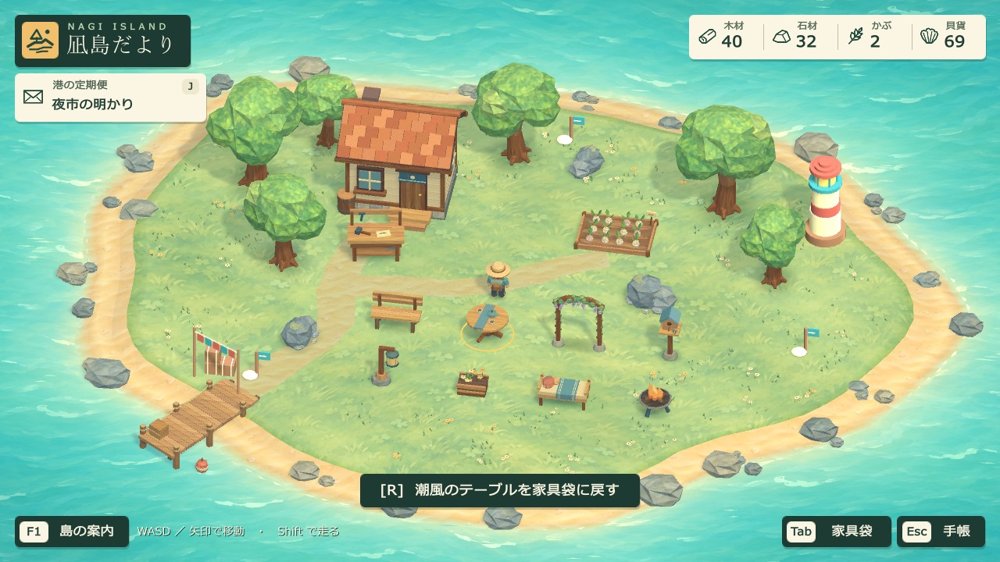

# 凪島だより

小さな島で家と畑を整え、港に船を呼ぶWindows向けの3D開拓ゲームです。渡し守の最初の頼みは、傷んだ船着き場の修繕。木と岩のそばで E を押して木材3と石2を集めましょう。J で依頼を開き、「依頼を納品する」を押すと第一便が出ます。

## すぐに遊ぶ

[NagiIsland.exe](Builds/Windows/NagiIsland.exe) をダブルクリックします。別のPCに移すときは、DLLやデータが入った `Builds/Windows` フォルダごとコピーしてください。

| 操作 | キー |
| --- | --- |
| 画面の上下左右に歩く | WASD または矢印 |
| 採集、作業台、種まき、収穫、配置の確定 | E |
| 家具袋を開く・閉じる | Tab |
| 家具を90度回す（配置中）・家具を袋に戻す（設置済みの家具のそば） | R |
| 配置を取りやめる・画面を閉じる・手帳を開く | Esc |
| 島の案内 | F1 |
| 島の依頼を読む・納品する | J |
| 道具の強化・素材を出荷する | U |
| 走る・カメラを近づける | Shift＋移動・マウスホイール |
| 島の写真をPNGで保存する | F12（セーブと同じ場所の Photos フォルダ） |

## 島でできること

- **開港までの8章**で、船に家具を届けたり、広場にアーチを飾ったりします。船荷は家具袋から渡します。島の発展とともに桟橋に荷物と旗が増え、開港祭には東岬に灯台が建ちます。その先には6種類の定期便があります。
- **交易と道具**。納品や素材の出荷で貝貨が手に入ります。採集、栽培、交易の道具を各2段階強化でき、採集量、成長時間と収穫量、販売収入が変わります。開拓に合わせて作れる家具が3種類から9種類へ増えます。
- **浜辺図鑑**。桟橋の入り江、北の磯、東の砂州にある青い目印で E を押します。波の指針が3つの帯のどれに入ったかで漂着物が変わります。全9点に標本画と観察メモがあります。
- **島の庭展**。手帳から公募を選び、広場の家具の組み合わせや向きを工夫して出品できます。完成した展示はスタンプとして残ります。

**最初のベンチを作るには**、木と岩に近づいてそれぞれ E を押します。小屋の手前の作業台で「海辺のベンチ」を作り、Tab の家具袋から「飾る」を選びます。手前の広場に8つの区画が現れるので、空き区画のそばに立ってそちらを向き、緑の枠で E を押してください。木材や石を使うのは製作時だけです。飾り直すときは家具のそばで R を押すと、完成品が袋に戻ります。

**畑は島の右奥**にあります。畑のそばで E を押すと種をまけます。かぶが白く育ったら、もう一度 E で収穫できます。初期設定では木が22秒、岩が18秒で復活し、かぶは35秒で育ちます。ゲームを閉じている時間も数えます。

## 保存と再開

採集・製作・配置・撤去・畑仕事の直後に自動保存します。移動中は約5秒ごと、終了時にも位置を保存します。Esc の手帳から手動保存もできます。次回起動すると、所持品、家具の区画と向き、作物や資源の状態、達成済みの目標を引き継ぎます。

Windows の保存先は `%USERPROFILE%\AppData\LocalLow\NagiIsland\Nagi Island\island-v1.json` です。直前の保存は同じフォルダの `island-v1.json.bak` に残ります。Unity Editor と Windows 版は同じセーブを使います。

## Unityで手動拡張する

1. Unity Hub の「追加」で、この README がある `IslandHomestead` フォルダを選びます。制作バージョンは **Unity 6.3 LTS（6000.3.28f1）** です。
2. Project ウィンドウで [NagiIsland.unity](Assets/Island/Scenes/NagiIsland.unity) を開き、▶ で遊べます。
3. 編集するときは再生を止め、変更を保存します。Windows 版の更新は上部メニューの **Island → Build Windows Player** です。現在のシーンとアセットから同じ場所に EXE を作ります。

### 家具を1種類追加する

例として「丸太の腰掛け」を増やす手順です。

1. 自作モデルを原点に置き、底面を Y=0 に合わせて Prefab にします。最初は1区画（幅2 m・奥行1.8 m）に収まる大きさが目安です。[既存の家具Prefab](Assets/Island/Art/Prefabs) も見本にできます。
2. [家具のレシピフォルダ](Assets/Island/Resources/Island/Furniture) で `01_Bench` を複製し、アセット名を `04_LogStool` にします。
3. Inspector で `Id` を `log-stool`、`Display Name` を「丸太の腰掛け」、`Wood Cost` を 2、`Stone Cost` を 0 にし、`Prefab` にモデルを割り当てます。
4. 再生して作業台を開くと新しい家具が並びます。製作・回転・撤去・保存も既存の家具と同じ操作です。レシピの並び順はアセット名の順です。

### 木や岩、家具の区画を増やす

- **木と岩**はシーンの Hierarchy で「採集ポイント」を展開します。「広葉樹」または「岩場」の親オブジェクトを複製して移動し、Inspector の `Island Spot → Id` に `tree-07` などの新しい値を入れます。`Resource Yield` は1回の採集量、`Regrow Seconds` は復活までの秒数です。
- **家具の区画**は「家具を置ける区画」の子を複製して移動し、新しい `Id` を付けます。既存の区画中心から約3 m離し、陸地でプレイヤーが横に立てる場所に置くと配置しやすくなります。
- **作物**の成長時間や見た目は「家・作業台・畑 → かぶ畑」の `Crop Grow Seconds`、`Alternate`（芽）、`Ripe`（収穫できる作物）で変更できます。初版のセーブは畑1面分です。
- **地形と移動範囲**は別々に編集できます。「島の風景」の地形モデルを差し替えたら、「凪島だより」の `Walkable Radii` で歩ける楕円のX・Z半径も合わせます。プレイヤーが歩く地表は Y=0 です。

セーブには家具、資源、区画の `Id` を記録します。**既存のものは同じIDを使い続け、追加するものに新しいIDを付けてください。** 表示名・モデル・素材コスト・シーン上の位置は個別に変更できます。

新版の家具は `Unlock After Chapters` で解放までに必要な納品章数を指定します。依頼内容は [IslandEconomy.cs](Assets/Island/Scripts/IslandEconomy.cs)、庭展のお題は [IslandExhibitions.cs](Assets/Island/Scripts/IslandExhibitions.cs) にあります。

地面、水面、木材などの絵柄は [テクスチャフォルダ](Assets/Island/Art/Textures) にあります。共有マテリアルの各欄で差し替えられます。タイトルの[港の絵](Assets/Island/Resources/Island/Media/Harbor.png)と図鑑の[標本画](Assets/Island/Resources/Island/Media/Specimens.png)は、画像生成で制作したゲーム用の原画です。前者は「左に余白のある海と松、右に陽の差す瓦屋根と桟橋を配したガッシュ風の港」、後者は「象牙色の紙に、水彩の貝・漂着物を3×3で並べた博物図譜」として制作しました。標本画は同じ3×3の配置で入れ替えられます。

### 処理を変更する場所

| 変更したい内容 | ファイル |
| --- | --- |
| 素材、所持品、農業、目標、セーブ形式 | [IslandState.cs](Assets/Island/Scripts/IslandState.cs) |
| 移動、操作できる距離、家具の配置と回収 | [IslandGame.cs](Assets/Island/Scripts/IslandGame.cs)、[IslandSpot.cs](Assets/Island/Scripts/IslandSpot.cs) |
| 家具レシピの項目 | [FurnitureRecipe.cs](Assets/Island/Scripts/FurnitureRecipe.cs) |
| 画面表示と操作案内 | [IslandHud.cs](Assets/Island/Scripts/IslandHud.cs) |

Unity の **Island → Tools → Check Gameplay Rules** で、素材の消費、配置と撤去、作物、保存の整合性を検証できます。**Check Playable Scene** は実際の島で採集から目標達成・再読込までを通します。検証時のセーブは一時ファイルに作ります。
